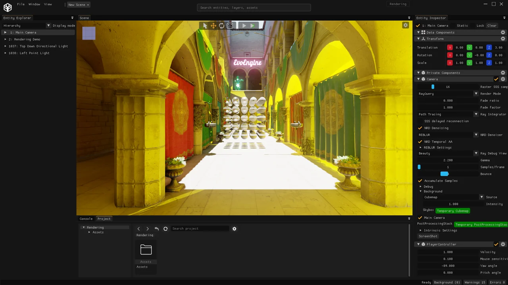
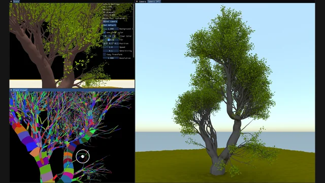
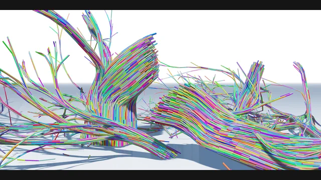
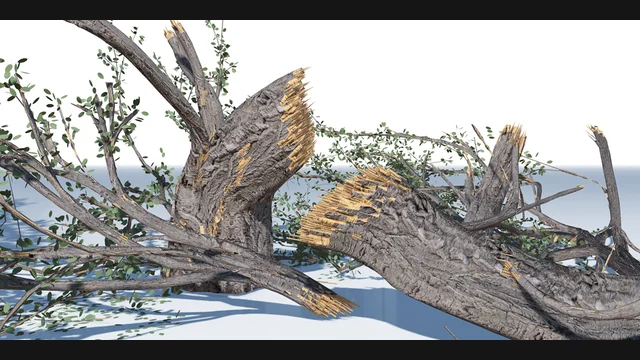
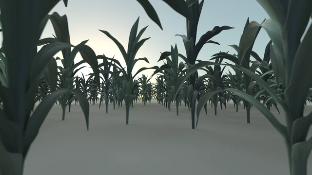
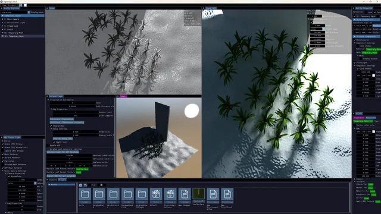

<picture>
  <source media="(prefers-color-scheme: dark)" srcset="EvoEngine_SDK/Internals/DefaultResources/Icons/EvoEngineWhite128.png">
  
</picture>

# EvoEngine

[](https://github.com/edisonlee0212/EvoEngine/actions/workflows/Windows-RelWithDebInfo.yml)
[](https://github.com/edisonlee0212/EvoEngine/actions/workflows/Windows-Debug.yml)
[](https://github.com/edisonlee0212/EvoEngine/actions/workflows/Linux-RelWithDebInfo.yml)
[](https://github.com/edisonlee0212/EvoEngine/actions/workflows/Linux-Debug.yml)
[](https://github.com/edisonlee0212/EvoEngine/actions/workflows/FormatCheck.yml)

EvoEngine is a C++17 research framework for interactive simulation, digital forestry, digital agriculture, synthetic
datasets, and Vulkan rendering. It combines a reusable runtime SDK, an ImGui editor, extensible domain packages, and
Python automation. Projects can be edited and simulated interactively, then exported as standalone Windows applications.

**Source-available for inspection, learning, and direct contribution.** See [LICENSE](LICENSE) for permissions and terms.

[](Resources/GitHub/RenderingDemo.png)

## Capabilities

| Area | Included workflows |
| --- | --- |
| Research and simulation | Procedural trees and ecosystems, digital crops, strand-based modeling and fracture, synthetic data, and procedural galaxies. See the [package index](EvoEngine_Packages/README.md). |
| Vulkan rendering | Rasterization, path tracing through ray-tracing pipelines or inline ray queries, glTF/PBR materials, skinned meshes, strands, and Gaussian splats. |
| Lighting and materials | DDGI, SDFGI and HDDAGI; reflection probes and stochastic screen-space reflections; [subsurface scattering](docs/subsurface-scattering.md). |
| Ray-camera denoising | Optional [NVIDIA NRD integration](docs/ray-camera-denoising.md). ReSTIR PT reuse modes are experimental; see [rendering](docs/rendering.md). |
| Editor and applications | Scene/asset editing, simulation playback, profiling, [runtime GUI](docs/runtime-gui.md), and [Windows runtime exports](docs/runtime-builds.md) with loading screens and persistent shader caches. |
| Extensibility | Runtime packages with separate editor companions, components, systems, assets, rendering callbacks, and [Python capture/automation](docs/python-bindings.md). |

Windows is the primary development platform; Linux has core compilation coverage. Ray tracing, ray query, mesh shaders,
and GI providers depend on device capabilities. Runtime export currently targets Windows x64; MeshRepair and
TextureBaking are Windows-only. The optional PhysX Service is disabled, and package-specific Python C++ bindings for
EcoSysLab/DigitalAgriculture are currently disabled. The CI badges report compilation/format checks; GPU and image-quality
validation runs locally. See [testing](docs/testing.md) for coverage.

## Requirements and Quick Start

For the standard Windows preset, install:

- **Visual Studio 2026**, including Desktop development with C++.
- **CMake 4.2 or newer**, which provides the Visual Studio 18 2026 generator.
- **Vulkan SDK** and a driver/GPU supporting the renderer features you intend to use.
- **Git** and **Python 3**; Python bindings require a matching Python development installation and interpreter.

```powershell
git clone --recursive https://github.com/edisonlee0212/EvoEngine.git
cd EvoEngine
python Scripts/install_apps.py
.\out\install\vs2026-x64\bin\EvoEngineLauncher.exe
```

The installer configures, builds and installs the launcher, editor, Python bindings and matching native runtime template.
The standard preset enables NRD; its pinned sources are supplied through third-party submodules. If you cloned without
submodules, run `git submodule update --init --recursive` first.

Choose a demo in the launcher, create a project, or open an existing `.eveproj`. To launch Sponza directly:

```powershell
.\out\install\vs2026-x64\bin\EvoEngineEditor.exe --demo rendering
```

First launch can spend time compiling shaders and creating pipelines. Progress is shown during preparation; compatible
shader/pipeline caches are reused on later launches. Some demos require external model downloads. Use the
[demo preparation guide](docs/rendering-demos.md#preparing-generated-resources) before opening unavailable profiles.

For subsequent builds, use `python Scripts/install_apps.py --incremental`. See [building](docs/building.md) for Linux,
Python selection, solution generation, configuration switches, and a test-enabled development build.

## Demo Gallery

Thumbnails link to full-resolution images. Rendered views are engine captures; editor views show the authoring interface.

| Sponza: raster lighting | Human skin: subsurface scattering |
| --- | --- |
| [](Resources/GitHub/SponzaDemo.png) | [](Resources/GitHub/SubsurfaceScatteringDemo.png) |
| `rendering` — materials, GI, lights and shadows | `sss` — path-traced skin diffusion; [demo and asset attribution](Resources/SubsurfaceScattering/README.md) |

| Bistro: path tracing | Bicycle: Gaussian splatting |
| --- | --- |
| [](Resources/GitHub/BistroDemo.png) | [](Resources/Launcher/DemoPreviews/bicycle.png) |
| `bistro` — external scene assets required | `bicycle` — downloaded Gaussian-splat model required |

| Procedural Galaxy | EcoSysLab |
| --- | --- |
| [](Resources/GitHub/GalaxyDemo.png) | [](Resources/GitHub/TreeFrameworkDemo.png) |
| `procedural-galaxy` — Universe package | Tree and ecosystem authoring |

| Strand modeling | Tree fracture |
| --- | --- |
| [](Resources/GitHub/StrandVisualization.png) | [](Resources/GitHub/TreeFracture.png) |

| Crop illumination | Synthetic agricultural data |
| --- | --- |
| [](Resources/GitHub/SorghumEnvLighting.png) | [](Resources/GitHub/IlluminationEstimationDemo.png) |

## Developing and Exporting Applications

For batch tree datasets without the editor, use
[ZachQSMTreeDatasetGenerator](Scripts/ZachQSM/README.md). It exports native EcoSysLab skeletons,
closed OBJ/PLY wood meshes, optional leaves, measurements and figures through the `zach-headless` preset.

A typical workflow is **open/create a project → edit and simulate → save scenes/assets → export → run independently**.
Use **View > Build Manager** to choose a saved startup scene and export a Windows x64 application. The runtime loads
its packaged scene and required packages without the editor. Its startup screen reports scene and shader/pipeline work;
projects can choose a custom startup logo. See [runtime builds](docs/runtime-builds.md).

The core `EvoEngine_SDK` owns runtime systems and shared GUI infrastructure. `EvoEngine_EditorSDK` owns editor panels,
inspectors and authoring tools. Runtime packages have separate editor companions, so exported applications exclude
editor tooling. Add runtime components and editor inspectors through the [editor extension workflow](docs/editor-extension-workflow.md).

## Documentation

| I want to… | Start here |
| --- | --- |
| Build and open my first project | [Getting started](docs/getting-started.md) · [Build/install](docs/building.md) · [Demo profiles](docs/rendering-demos.md) |
| Understand or extend the engine | [Architecture](docs/architecture.md) · [Extension choices](docs/extending-evoengine.md) · [Editor adapters](docs/editor-extension-workflow.md) |
| Work with project content | [Projects, assets and serialization](docs/projects-assets-serialization.md) · [Runtime packages](docs/runtime-packages.md) |
| Explore rendering | [Renderer overview](docs/rendering.md) · [GI](docs/rendering-gi.md) · [SSS](docs/subsurface-scattering.md) · [Denoising](docs/ray-camera-denoising.md) |
| Export a standalone application | [Build Manager](docs/runtime-builds.md) · [Runtime GUI](docs/runtime-gui.md) |
| Automate or measure a workflow | [Python bindings](docs/python-bindings.md) · [CPU/GPU profiler](docs/profiler.md) · [Shader preparation](docs/shader-preparation.md) |
| Validate a change | [Testing](docs/testing.md) · [Rendering validation](docs/rendering-validation.md) |

<details>
<summary>Repository map</summary>

| Path | Purpose |
| --- | --- |
| `EvoEngine_SDK` | Runtime SDK; separate editor SDK under `Editor/`. |
| `EvoEngine_App` | Launcher, editor, runtime host, exporter, and shared demos. |
| `EvoEngine_Packages` | [Runtime packages and editor companions](EvoEngine_Packages/README.md). |
| `EvoEngine_Services` | Optional [build-time Service integrations](EvoEngine_Services/README.md). |
| `EvoEngine_Tests` | Native, GPU/render, and application smoke tests. |
| `PythonBinding` | Python modules and automation examples. |
| `Resources` | Demo projects, sample assets and screenshots. |
| `Scripts`, `cmake` | Build, deployment, validation and formatting tooling. |
| `Extern` | Vendored dependencies and submodules. |

</details>

## Related Publications

EvoEngine supports research workflows used in digital forestry and agriculture.

### Trees, ecosystems and procedural modeling

- [Learning to Reconstruct Botanical Trees from Single Images, SIGGRAPH Asia 2021](https://storage.googleapis.com/pirk.io/projects/single_tree_reconstruction/index.html)
- [Rhizomorph: The Coordinated Function of Shoots and Roots, SIGGRAPH 2023](https://storage.googleapis.com/pirk.io/projects/rhizomorph/index.html)
- [DeepTree: Modeling Trees with Situated Latents, TVCG 2023](https://storage.googleapis.com/pirk.io/projects/deep_tree/index.html)
- [Latent L-systems: Transformer-based Tree Generator, SIGGRAPH 2024](https://dl.acm.org/doi/pdf/10.1145/3627101)
- [Tree-D Fusion: Simulation-Ready Tree Dataset from Single Images with Diffusion Priors, ECCV 2024](https://link.springer.com/chapter/10.1007/978-3-031-72940-9_25)
- [Interactive Invigoration: Volumetric Modeling of Trees with Strands, SIGGRAPH 2024](https://storage.googleapis.com/pirk.io/projects/invigoration/index.html)
- [TreeStructor: Forest Reconstruction With Neural Ranking, TGRS 2025](https://lewkesy.github.io/treestructor/)
- [Stressful Tree Modeling: Breaking Branches with Strands, SIGGRAPH 2025](https://dl.acm.org/doi/10.1145/3721238.3730745)
- [Woodstock: Interactive Modeling of Fungal Wood Decay, SIGGRAPH 2026](https://jango6324.github.io/woodstock/)

### Digital agriculture

- [3D reconstruction identifies loci linked to variation in angle of individual sorghum leaves, PeerJ](https://peerj.com/articles/12628/)
- [Sorghum segmentation and leaf counting using in silico trained deep neural model, The Plant Phenome Journal](https://acsess.onlinelibrary.wiley.com/doi/pdf/10.1002/ppj2.70002)
- [PlantSegNet: 3D point cloud instance segmentation of nearby plant organs with identical semantics, Computers and Electronics in Agriculture](https://www.sciencedirect.com/science/article/abs/pii/S0168169924003132)

## Contributing

Contributions directly to EvoEngine are welcome under the [license terms](LICENSE). Start with the relevant focused
guide, keep changes scoped, and follow [AGENTS.md](AGENTS.md). Use the clang-format version in `.clang-format-version`:

```powershell
python Scripts/format_cpp.py --check
```

Run the relevant [tests](docs/testing.md) before submitting a pull request. GPU tests require suitable local hardware;
include the OS, GPU/driver, reproduction steps, logs and captures when reporting a rendering issue.

## License

EvoEngine is source-available for inspection, learning, and direct contribution only. It is not open source. You may not copy, reuse, redistribute, publish, sublicense, incorporate, or commercially use EvoEngine code, assets, documentation, or other repository content without prior written permission.

Contributions are welcome. You may fork, clone, build, and modify EvoEngine solely to prepare contributions directly back to this repository. See [LICENSE](LICENSE) for the full terms.
