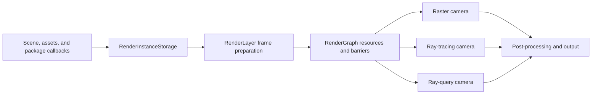

# EvoEngine Rendering

[Back to README](../README.md)

EvoEngine uses a Vulkan renderer built around `RenderLayer`.

Focused guides:

- [Materials and geometry](rendering-materials.md)
- [Texture access](rendering-texture-access.md)
- [Global illumination: DDGI, SDFGI, and HDDAGI](rendering-gi.md)
- [Reflection probes](reflection-probes.md)
- [Stochastic SSR](rendering-ssr.md)
- [ReSTIR path tracing](restir-path-tracing.md)
- [Ray-camera denoising](ray-camera-denoising.md)
- [Subsurface scattering](subsurface-scattering.md)
- [Rendering demos](rendering-demos.md)
- [Rendering validation](rendering-validation.md)

## Architecture

### Image layouts and synchronization

First-party GPU images use `VK_IMAGE_LAYOUT_GENERAL`. New images transition from `UNDEFINED`; presentation uses
`PRESENT_SRC_KHR`. Render-graph declarations drive barriers and queue ownership even with equal layouts.
DDGI atlases are initialized before descriptor publication.

### Rendering flow

| Owner | Responsibility |
| --- | --- |
| `Camera` | View state, output texture, visible background, requested render technique, ray settings, and post-processing stack. |
| `Scene` | Renderable entities, lights, the main camera, environmental-lighting reference, and global reflection-probe fallback. |
| `EnvironmentalLighting` | Indirect GI provider, shared probe layout, DDGI/SDFGI/HDDAGI settings, environment source, reflection probes, and fallback intensities. |
| `RenderInstanceStorage` | Immutable per-frame GPU view of geometry, materials, transforms, lights, cameras, environment data, descriptors, and acceleration-structure inputs. |
| `RenderGraph` | Logical resources, pass ordering, access declarations, transient allocation, and Vulkan barrier planning. |
| `RenderLayer` | Pipeline creation, frame preparation, shadows, camera rendering, probe work, extension callbacks, diagnostics, and output handoff. |

Camera passes consume immutable snapshots. Static rigid renderers may reuse records; visibility, LOD, and draw lists
update each frame.

## Shader Source Policy

First-party shaders use `.slang` or `.slangh`, with modules and `import` for shared code. Legacy extensions, GLSL
compatibility syntax, and textual `#include` are rejected. Third-party `Extern/` code is exempt.

## Frame Flow

After scene updates, `RenderLayer::PrepareForRendering` gathers instances and lighting, uploads geometry/textures, and
prepares acceleration structures and descriptors. Shared shadows, GI and probe work precede camera graphs and
post-processing. Frame-slot fences retain resources until submitted GPU work finishes.

## Static Scene Contract

`Scene::SetEntityStatic(entity, true)` enables record reuse for unchanged rigid meshes in a root hierarchy.
Skinned meshes, particles, strands, splats, external renderers, and API draws remain dynamic.

Scene/editor structural edits invalidate caches automatically. Code that directly changes a static transform or renderer
must call `RenderLayer::NotifyStaticEntityChanged(scene, entity)` afterward. Otherwise raster and ray inputs can remain
stale. Unchanged TLAS inputs reuse existing acceleration structures; changed inputs trigger the required build or update.

## Camera Techniques

| Technique | Rendering path | Availability behavior |
| --- | --- | --- |
| Rasterization | Raw opaque/masked GBuffer, fused compute material evaluation and lighting, forward/transparent rendering, then post-processing. | Always available. |
| Ray tracing | Vulkan ray-tracing pipeline running the shared path-tracing integrator. | Falls back to ray query when available, otherwise rasterization. |
| Ray query | Compute pipeline using inline ray queries with the shared path-tracing integrator. | Falls back to ray tracing when available, otherwise rasterization. |

The resolved technique is reported when it differs from the camera request. Ray tracing and ray query share material
evaluation, BSDF logic, environment and emissive sampling, path controls, debug views, and optional outputs. Solid SSS
uses a dedicated closest-hit group in Ray Tracing; RayQuery evaluates it in compute.

Ray cameras accumulate independently. Resizing, technique, settings, and scene changes invalidate affected histories;
unchanged cameras continue accumulating.

For Path Tracing with NRD disabled, **Display firefly strength** (default 1) suppresses isolated bright pixels in the
displayed average; **Display firefly ratio** (default 1) sets how much brighter a pixel must be than its brightest
3×3 neighbor before suppression. The filter reads accumulated history but writes only the current result, so
adjusting either display control does not restart accumulation. It runs only in the Beauty view and can also suppress
legitimate one-pixel highlights. Strength 0 displays the unfiltered result. Path samples are accumulated without a
firefly clamp; nonfinite radiance is rejected.
Preview captures accept `--preview-display-firefly-strength 0..1` and `--preview-display-firefly-ratio 1..20` for
matched filtered and unfiltered comparisons without editing the scene.

### ReSTIR PT ray integrators

Candidate Only, Spatial Only, Temporal Only and Enhanced run through RayQuery. Reuse is experimental; history confidence
is not an independent-sample count, and raw accumulation can remain correlated. Ordinary PT is the comparison baseline.
See [ReSTIR path tracing](restir-path-tracing.md) for controls, supported scenes, histories, signals and capture options.

### Ray-camera pass flow

Ray-tracing cameras dispatch a ray-generation pipeline; ray-query cameras dispatch compute threads using inline ray
queries. Both call `CameraRayIntegrator` for materials, light sampling, bounces, and accumulation, then run optional
volumetric clouds, Gaussian splats, and post-processing. Ray cameras trace indirect lighting directly and can output
albedo, normals, ray counts, path lengths, timing, and debug data.

## Raster Path

The camera graph records raw GBuffer/depth, motion vectors, depth pyramid, optional GTAO, deferred material evaluation
and lighting, forward/transparent geometry, optional splats/overlays and post-processing. Opaque geometry writes raw
attributes and IDs; masked geometry also samples alpha. GTAO uses geometric normals before material evaluation.

GI field updates and point/spot shadows are shared across cameras. HDDAGI prepares full-resolution camera GI before
composition. DDGI uses HDDAGI voxel visibility only when occlusion is enabled; it has no SDF/HDDAGI transport history.
Reflection captures use a reduced diffuse-only GI path. Disabled stages are skipped.

Material/environment/probe assets share bindless 2D and cubemap arrays; attachments and histories retain explicit
bindings. See [Texture access](rendering-texture-access.md) and [Materials and geometry](rendering-materials.md).

## Lighting

Direct lighting comes from directional, point, and spot lights. Environment and probe inputs are resolved from the scene
and its `EnvironmentalLighting` asset before rendering.

Choose Environment, Automatic DDGI, Automatic SDFGI (default), or Automatic HDDAGI. The selected automatic provider
updates a shared camera-anchored field; unsupported or unready coverage uses Environment fallback.
See [Global illumination](rendering-gi.md) for provider differences, controls, update passes, and known limitations.

| Use | Source and control |
| --- | --- |
| Visible primary background | The camera background source multiplied by `background_intensity`. |
| Raster diffuse indirect | Valid irradiance from the selected provider; otherwise the indirect environment source multiplied by `diffuse_fallback_intensity`. |
| Raster specular indirect | Selected GI, reflection probes, and environment fallback; local probes and SSR retain composition priority. |
| Ray-camera environment events | The indirect environment source multiplied by `environment_lighting_intensity`. |
| Reflection-probe capture background | The authored bake background, with inherited environment radiance multiplied by `environment_lighting_intensity`. |

All three environmental-lighting intensities default to `1.0`. Visible camera backgrounds are independent from indirect
lighting. Ray cameras do not use raster diffuse or specular fallback intensities, and they do not use the scene-global
prefiltered reflection probe as their environment radiance source.

## Shadows And Post-Processing

Directional lights use four cascades with Stable Sphere fitting by default; Tight Light-Space AABB fitting is available
for comparison. Directional shadows use Vogel-disc percentage-closer filtering. Point and spot lights use their own
shadow atlases and filtering paths. The quality override changes directional, point, and spot shadow-map resolution
together. Every shadow type separates opaque and alpha-masked rigid, meshlet, instanced, skinned, and strand casters.
Opaque depth shaders perform no material or texture access; masked depth shaders evaluate only base-color alpha
coverage. External shadow renderers register explicitly for one of those two contracts.

Raster cameras can use GTAO ambient occlusion, screen-space reflections, SMAA, bloom, tone mapping, and related post
effects from their `PostProcessingStack`. Ray cameras apply bloom and tone mapping after path tracing. Post-processing
resources and temporal histories are camera-owned. Assets must use the current flat GTAO and SMAA schemas.

Bloom's **Compression start** (2) and **Source ceiling** (8) bound sampled HDR contributions before downsampling,
preserving color ratios. They limit the bloom source, not the original scene color or final composited halo.

DDGI visibility and sparse-support controls are described in [GI](rendering-gi.md). Valid blocked probes stay dark.

### Stochastic SSR

SSR estimates a signed correction to existing specular lighting. Probe, GI and environment fallback remain available on
misses. Roughness-aware spatial filtering and temporal reconstruction reduce sample noise without blurring diffuse light.
See [SSR controls and limitations](rendering-ssr.md); one-frame samples, dynamic lighting and disocclusions can remain noisy.

## Geometry And Optional Features

Regular, skinned, instanced, transparent, strand, Gaussian-splat, and externally registered geometry enter the renderer
through separate render-instance collections. Participation depends on the selected pass and the data supplied by the
renderer owner.

Strands use the mesh-shader raster path when supported. Ray cameras also include strands when the Vulkan device exposes
`VK_NV_ray_tracing_linear_swept_spheres` with `linearSweptSpheres`. Without that capability, strands are omitted from ray
tracing and ray query while raster strand rendering remains available. DDGI does not traverse strand geometry.

## Extending Rendering

Packages register render-graph resources/passes, render instances, shaders and descriptors through public APIs.
`RenderLayer` exposes deferred, forward/transparent, shadow and gizmo callbacks. Opaque and alpha-only masked callbacks
have separate contracts. External geometry participates only where it supplies the required draw/traversal data;
DDGI requires triangle acceleration structures and offsets.

## Source Entry Points

Start with `RenderLayer`, `Camera`, `RenderGraph`, and `RenderInstanceStorage` in `EvoEngine_SDK`. Material and lighting
shader modules live under `EvoEngine_SDK/Internals/DefaultResources/Shaders/Modules/EvoEngine`.

## Subsurface scattering

Opt-in `.evesss` profiles, deferred radial diffusion, solid PT diffusion, and thin-sheet transport are under validation. See [subsurface scattering](subsurface-scattering.md) for authoring, transport semantics, and current limitations.
